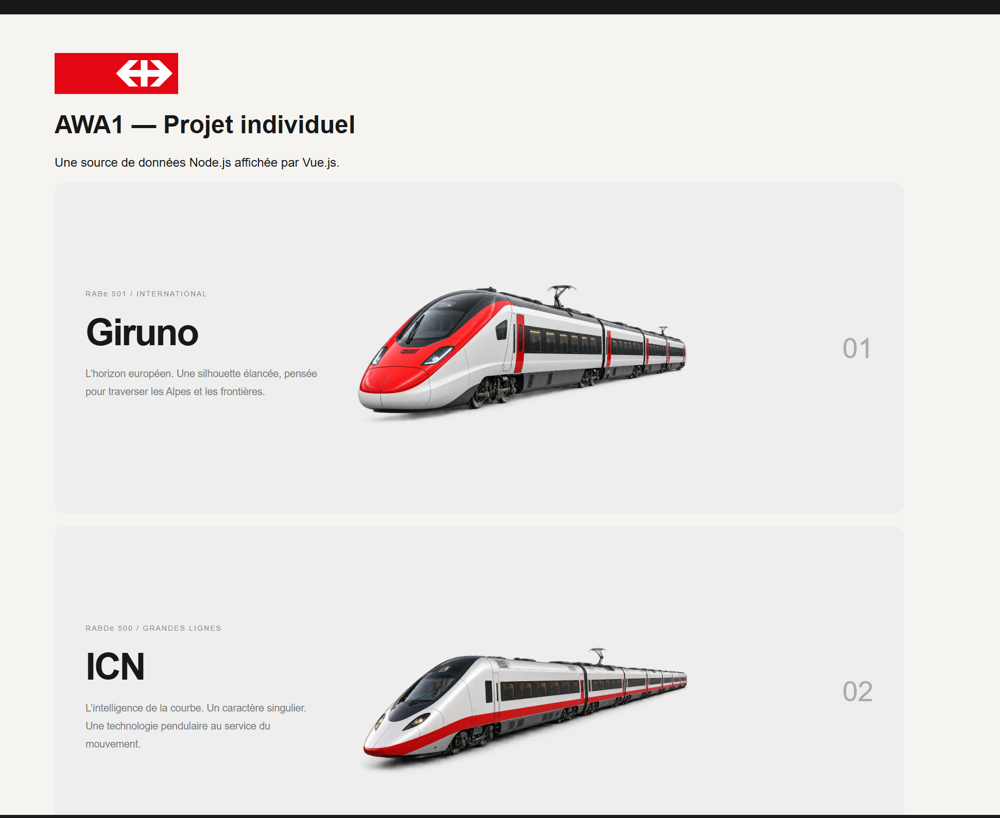
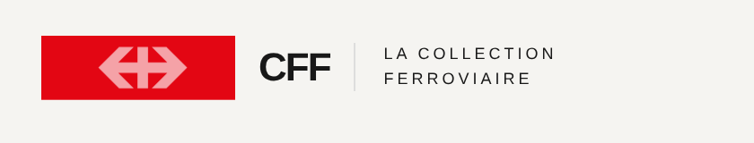

# AWA1 — CFF Collection

Une collection de trains suisses (Giruno, ICN, FV-Dosto). On parcourt les trains, puis on ouvre la fiche de l'un d'eux.

> Concept de présentation indépendant · Non affilié aux CFF. Visuels repris de la maquette « CFF Collection ».

## Prérequis

Node.js LTS, npm, éditeur de code et navigateur.

## Démarrage

1. Installer les dépendances : `npm install`
2. Terminal 1 : `npm run server` (API à `http://localhost:3001/api/items`)
3. Terminal 2 : `npm run dev` (ouvrir l'URL Vite affichée)

## API

| Route | Réponse |
|---|---|
| `GET /api/items` | Liste des 3 trains (id, code, nom, description, image) |

## Organisation

```
server/index.js                API Express (données des trains)
public/images/                 Images des trains
src/App.vue                    En-tête, page d'arrivée, liste, fiche d'un train, rideau
src/style.css                  Styles généraux et animations CSS
src/components/LogoCff.vue     Logo CFF en SVG inline, animé et paramétrable
src/components/HomeHero.vue    Page d'arrivée (Giruno)
src/components/HomeHero.css    Styles de la page d'arrivée
docs/                          Captures pour les reviews
```

---

## S2 — Interactions CSS

### Interaction 1 — Survol d'une carte (transition)

- **Besoin :** montrer qu'une carte est cliquable, sans déplacer le reste de la page.
- **Déclencheur :** `:hover` (souris) et `:focus-visible` (clavier, touche Tab).
- **Effet :** le fond de la carte fonce légèrement et le train avance et grandit (`transform: translateX(-10px) scale(1.03)`).
- **Pourquoi une transition :** il y a deux états (normal / survolé). La transition adoucit le passage à l'aller et au retour, car elle est placée sur l'état de départ.
- **Pourquoi `transform` :** il ne recalcule pas la mise en page, donc rien d'autre ne bouge.

### Interaction 2 — Rideau rouge entre la liste et la fiche (@keyframes)

- **Besoin :** signaler clairement le changement de vue quand on ouvre un train ou qu'on revient à la collection.
- **Déclencheur :** clic ou touche Entrée sur une carte, ou sur « ← La collection ». Vue ajoute la classe `.run` et le CSS joue l'animation.
- **Effet :** le rideau monte, recouvre l'écran (la vue change à ce moment), puis repart par le haut.
- **Pourquoi des keyframes :** l'animation a 3 étapes (0 %, 50 %, 100 %). Une transition ne va que d'un état à un autre.
- **Robustesse :** les clics répétés pendant l'animation sont ignorés.

### Accessibilité

- Les cartes sont atteignables au clavier (`tabindex="0"`) et s'ouvrent avec Entrée.
- `prefers-reduced-motion` : plus aucun mouvement. Le train ne glisse plus, il n'y a plus de rideau et la vue change immédiatement. Les états finaux restent visibles.

### Test clavier

| Étape | Résultat attendu | OK |
|---|---|---|
| `Tab` jusqu'à la première carte | Le fond fonce, le train avance | ☐ |
| `Tab` / `Maj + Tab` | Le focus passe d'une carte à l'autre, dans l'ordre | ☐ |
| `Entrée` sur une carte | Le rideau rouge passe, la fiche du train s'affiche | ☐ |
| `Tab` puis `Entrée` sur « ← La collection » | Le rideau passe, retour à la liste | ☐ |

### Test « réduire les animations »

Windows : Paramètres → Accessibilité → Effets visuels → désactiver « Effets d'animation », puis recharger la page.

| Étape | Résultat attendu | OK |
|---|---|---|
| Survol d'une carte | Le fond change, le train est directement à sa position finale | ☐ |
| Clic sur une carte | Pas de rideau, la fiche s'affiche tout de suite | ☐ |

---

## S3 — SVG inline animé

### Le composant `LogoCff.vue`

- **Quoi :** le logo CFF (rectangle rouge + emblème blanc), écrit **inline** dans le template (`<svg>…</svg>`), dans un composant Vue dédié.
- **Rôle dans l'interface :** signature de la collection dans l'en-tête. À l'arrivée sur la page, l'emblème glisse dans le rectangle rouge, comme un train qui entre en gare. L'effet joue une seule fois, puis le logo reste immobile.
- **Pourquoi inline :** chaque forme est un élément du DOM. Le `<path class="logo-emblem">` peut être ciblé et animé en CSS, ce qui est impossible avec ``.

### Animation

- **Forme animée :** uniquement l'emblème (`.logo-emblem`). Le rectangle rouge ne bouge pas.
- **Technique :** `@keyframes arrive`, de `translateX(-120px)` + `opacity: 0` à `translateX(0)` + `opacity: 1`, en 1 s, une seule fois.
- **Pourquoi `@keyframes` :** il n'y a ni survol ni clic. L'animation doit démarrer seule au chargement, ce qu'une transition ne permet pas.
- **Unités :** dans un SVG, `-120px` est exprimé en unités de la `viewBox`, pas en pixels écran. Ce qui sort du cadre est coupé par le `<svg>`.

### Paramètres (props)

| Prop | Type | Défaut | Effet |
|---|---|---|---|
| `width` | Number | `160` | Largeur d'affichage en px (`<LogoCff :width="108" />` dans l'en-tête) |
| `compact` | Boolean | `false` | `true` : la `viewBox` cadre seulement l'emblème (carré rouge) |

### À quoi sert la `viewBox` ?

La `viewBox` fixe le **repère de coordonnées** du dessin : `x y largeur hauteur`.

- Ici, `viewBox="142.24 457.687 220.333 73.158"` cadre exactement le rectangle rouge.
- La largeur affichée (`width`) choisit seulement la taille à l'écran : le dessin reste net à toutes les tailles, ses coordonnées ne changent pas.
- Avec `compact`, la `viewBox` devient `240 457.687 122.573 73.158` : **même dessin, autre cadrage**.

### Captures avant / après

| Avant (logo statique) | Après (emblème animé) |
|---|---|
|  |  |

### Accessibilité

- `role="img"` et `aria-label="Logo CFF"` : le logo est annoncé correctement par les lecteurs d'écran.
- `prefers-reduced-motion` : l'emblème est directement à sa place, sans glissement.

| Test | Résultat attendu | OK |
|---|---|---|
| Recharger la page | L'emblème glisse dans le rectangle rouge en 1 s, une seule fois | ☐ |
| Zoom à 400 % | Le logo reste parfaitement net | ☐ |
| « Réduire les animations » activé | L'emblème est directement à sa place | ☐ |

---

## Journal des changements

- **S2**
  - Style de la maquette (police Arial, couleurs CFF).
  - Données des 3 trains dans l'API et images dans `public/images/`.
  - Interaction 1 : survol et focus des cartes (transition sur le fond et le train).
  - Vue détail d'un train.
  - Interaction 2 : rideau rouge `@keyframes` entre la liste et la fiche.
  - Prise en charge de `prefers-reduced-motion`.

- **S3**
  - Composant `LogoCff.vue` : logo en SVG inline, props `width` et `compact`.
  - Animation de l'emblème au chargement (`@keyframes arrive`).
  - Page d'arrivée `HomeHero.vue` (mot « GIRUNO », train, barre du bas) avec son CSS dans `HomeHero.css`.
  - En-tête avec le logo, section « Trois signatures. Une collection. ».

## Sources et usages d'IA

- Maquette « CFF Collection » (code et images) générée avec ChatGPT.
- Exercices du cours : 01-css-transform, 02-css-keyframes.
- Claude (Anthropic) : aide à la mise en place du jalon S2, étape par étape (concrettement a lu le PPTX et ma donner une liste des taches) il a aussi aider pour le .md.
- Logo : reproduction du logo SBB CFF FFS (marque des Chemins de fer fédéraux suisses), redessinée à la main en SVG. Projet de cours, non affilié aux CFF.
- Exercices du cours : 03-svg, 04-svg-animation, 08-svg-vue.
- Claude (Anthropic) : aide pour le jalon S3 (nettoyage du SVG, composant Vue, animation, page d'arrivée, README).
